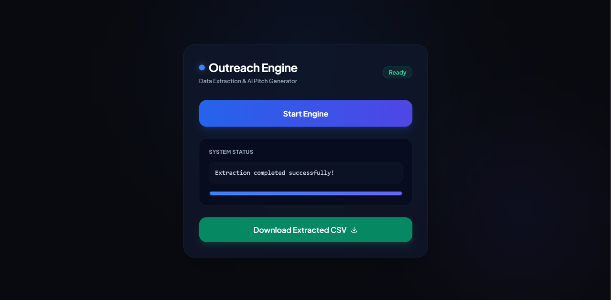

# 🚀 Outreach Engine

> **A high-performance, AI-powered automation engine designed to extract lead data and generate hyper-personalized cold outreach messages at scale.**


---

## 📌 Overview

**Outreach Engine** bridges lead data processing with generative AI capabilities. Built with **FastAPI** and **Google's Gemini API**, it reads lead details from structured CSV datasets and dynamically drafts context-aware, conversion-focused B2B cold pitches in real time.

The system features an asynchronous, multi-threaded pipeline and a modern, responsive dark-mode telemetry dashboard powered by **Tailwind CSS**.

---

## ✨ Key Features

- ⚡ **Asynchronous Multi-Threading:** Non-blocking background process execution allows real-time state updates, progress tracking, and mid-process pipeline cancellation.
- 🤖 **Contextual AI Generation:** Leverages Google's `gemini-3.8-flash` model to craft concise, customized outreach messages per lead.
- 📊 **Real-Time Telemetry Dashboard:** Includes live status updates, smooth progress indicators, and state badges via client polling.
- 🛡️ **Pydantic Data Validation:** Ensures strict schema parsing and data integrity on input files before feeding them into the AI engine.
- 📥 **Export to CSV:** Direct browser stream/save dialog for immediate review and deployment of generated messages.

---

## 🛠️ Architecture & Tech Stack

- **Backend:** Python 3.10+, FastAPI, Uvicorn
- **AI / LLM Layer:** Google GenAI SDK (`google-genai`), Gemini 3.8 Flash
- **Data Engineering:** Pandas, Pydantic
- **Frontend:** HTML5, Tailwind CSS (via CDN), JavaScript (Fetch API / Async Web API)

```text
outreach_engine/
├── app/
│   ├── api/          # FastAPI route handlers & HTML dashboard views
│   ├── core/         # Project configuration & Gemini Client setup
│   ├── models/       # Pydantic schemas for data validation
│   └── services/     # Multi-threaded extraction & AI pipeline execution
├── leads.csv         # Target leads dataset
├── main.py           # Application entrypoint & server bootstrap
└── requirements.txt  # Project dependencies
```

---

## 🚀 Quickstart Guide

### Prerequisites

Ensure you have the following installed locally:
- **Python 3.10+**
- A **Google Gemini API Key** (Get one from [Google AI Studio](https://aistudio.google.com/))

### Installation

1. **Clone the repository:**
   ```bash
   git clone https://github.com/Sir-Rumeh/outreach_engine.git
   cd outreach_engine
   ```

2. **Create and activate a virtual environment:**
   ```bash
   # On macOS/Linux
   python3 -m venv venv
   source venv/bin/activate

   # On Windows
   python -m venv venv
   venv\Scripts\activate
   ```

3. **Install dependencies:**
   ```bash
   pip install -r requirements.txt
   ```

4. **Environment Configuration:**
   Create a `.env` file in the project root:
   ```env
   GEMINI_API_KEY=your_actual_gemini_api_key_here
   ```

5. **Prepare Target Leads (`leads.csv`):**
   Ensure your root directory contains a `leads.csv` structured as follows:
   ```csv
   Name,Company,Email,Channel,ProfileURL,Focus
   Alex,Acme Corp,alex@acme.com,LinkedIn,https://linkedin.com/in/alex,React and Next.js scale
   ```

6. **Run the Application:**
   ```bash
   python main.py
   ```
   *The engine will automatically spin up Uvicorn and launch `http://127.0.0.1:8000` in your default browser.*

---

## 🖥️ Dashboard Interface

> *(Screenshots / Demo GIFs will be added here after the UI update)*


---

## 🛣️ Roadmap

- [ ] Interactive in-browser Data Table to view & edit generated pitches before export
- [ ] Support for multiple LLM providers (Anthropic, OpenAI)
- [ ] Containerization with Docker & Docker Compose
- [ ] Automated testing suite (`pytest`)

---
